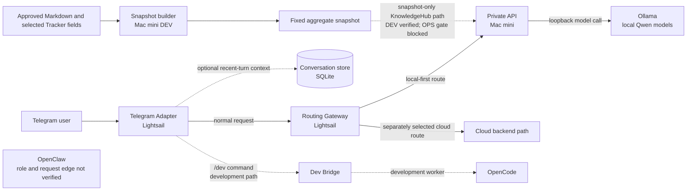
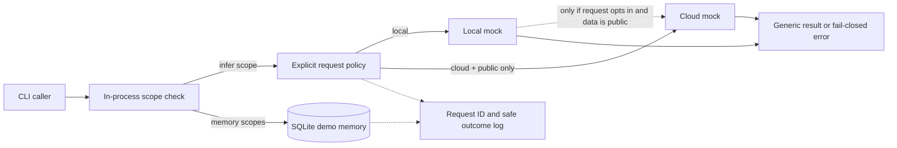

# Hybrid AI Assistant — Personal Project

This project explores how a personal AI assistant can combine private, on-device inference with the flexibility of a cloud model path while keeping routing, data boundaries, and failure behavior understandable.

## Why I Built This

I built a personal Hybrid AI Assistant connecting a cloud gateway on AWS Lightsail with local AI inference on a Mac mini.

The project began with a practical question: **How can I use local AI models for private tasks while retaining the flexibility of cloud AI, without losing control over routing, security, or failures?**

Through implementation and operation, I explored model routing, network boundaries, service reliability, access control, memory, automation, and recovery procedures.

## The Private System and This Repository

| | Personal Hybrid AI System | This Public Repository |
|---|---|---|
| Purpose | Personal assistant and development environment | Reproducible architecture-validation demo |
| Infrastructure | Lightsail, Mac mini, and private services | Standalone Python project |
| Models | Local Ollama plus a separate cloud execution path | In-process mock backends only |
| Routing | Telegram adapter and gateway integrations | Explicit Local/Cloud request contract with opt-in public-only fallback |
| Knowledge | Private KnowledgeHub inputs and a restricted snapshot design | No private documents or tracker data |
| Access and memory | Separate services, storage, and access controls | In-process scoped-token example and local SQLite example |
| Operations | Separate services, storage, and access controls | No production configuration or network calls |

**This repository is not a copy of the production system.** It is a clean-room demonstration of selected architectural decisions. The diagram and image below distinguish the broader personal system from the much smaller public demo.

## Full System Architecture

The solid paths show the documented service roles. Dashed paths are development-only or not confirmed as a current production integration. No operational hostnames, addresses, credentials, or private data are included.



### Roles and Integration Status

- **Lightsail Telegram Adapter and Gateway:** The Adapter handles Telegram updates and forwards requests to the Gateway. The Gateway exposes distinct status and inference routes and selects the execution path. Earlier operator checks confirmed the AWS status stage; those services were not re-inspected for this README update.
- **Mac mini Private Plane and Ollama:** The Private Plane API connects to a local Ollama model endpoint. A recorded DEV HTTP run used synthetic documents and made a real local Qwen request. This does not mean the public demo calls Ollama.
- **Local and cloud routing:** Gateway code and tests cover local, automatic, and cloud modes. The tested default prefers the Private Plane and has automatic cloud fallback disabled; a separate cloud route exists. This is not a blanket claim that every production request is classified or guaranteed private.
- **OpenClaw:** OpenClaw is named in the broader project context, but its operational role is not established by the reviewed code and reports. Its direct connection to the Telegram → Gateway → Private Plane request path is also unverified, so the diagram intentionally shows no connection.
- **KnowledgeHub:** A DEV snapshot pipeline reads an explicitly selected Markdown directory and selected Tracker fields, then emits a fixed aggregate schema. The API reader consumes that snapshot and fails closed on missing, stale, or invalid input. The latest recorded G2 status is **OPS BLOCKED**; no live KnowledgeHub search from the production service is claimed here.
- **Conversation memory:** The Telegram Adapter has an optional, bounded recent-conversation store with per-conversation isolation. Tests cover context limits and separation. This is short-term chat context, not KnowledgeHub search or vector memory.
- **Development automation:** A `/dev` path is documented in the Lightsail DEV branch through a local Dev Bridge to an OpenCode worker. A Codex executor is an opt-in prototype, not an always-on production feature. These tools are not included in this public repository.

## Memory, Search, and Automation Are Separate

The system uses three different ideas that should not be conflated:

1. **Conversation context** keeps a bounded window of recent turns for a chat when enabled.
2. **KnowledgeHub search** is designed around a restricted, aggregate-only snapshot. It is not a copy of the Markdown or Tracker source documents, and its OPS rollout remains blocked in the latest recorded release review.
3. **Developer automation** routes an explicit `/dev` request to a separate development worker. It is not the normal chat or KnowledgeHub path.

## Engineering Decisions and Lessons

- **Make route selection explicit.** A request identifies its intended provider; the public demo rejects private-classified requests before a cloud backend can run.
- **Avoid silent route changes.** The private system's tested default does not automatically send a failed local request to the cloud. The public demo can illustrate an explicitly requested local-to-cloud fallback for public data only; fallback is off by default and private requests cannot select it.
- **Keep KnowledgeHub output bounded.** The DEV snapshot contract uses an allowlist and freshness/integrity checks. Failure returns unavailable rather than serving an old snapshot. Synthetic tests cover this boundary; production rollout is still blocked.
- **Treat model capacity as a reliability constraint.** Mac memory and swap measurements informed model selection. A larger-model run was stopped by the existing safety guard after resource limits were exceeded; it was not promoted as a default.
- **Separate proof from deployment.** Release, credentials, snapshot ACL, and service-start checks are separate gates. A passing mock or DEV test is not described as a production deployment.
- **Be precise about timeouts.** The Router does not enforce a deadline. If a backend raises a timeout exception, it fails closed unless the request explicitly selected the allowed public-data fallback.

### Implementation Status

The table separates current public code from private-system work. Private-system entries summarize the latest available reports and code inspection; they were not re-run or independently re-certified during this README update.

| Area | Status | Evidence boundary |
|---|---|---|
| Public Local/Cloud router | **Implemented** | This repository contains the explicit request contract, mock backends, private-to-cloud rejection, and unit tests. |
| Public fallback policy | **Implemented** | Only an explicit `local_to_cloud` policy for a public request can use Cloud after Local fails; default is `never`. |
| Public authorization example | **Implemented as an in-process example** | A fixed-scope demo token gates inference and memory methods. It is not HTTP authentication, identity management, or a production security boundary. |
| Public conversation memory example | **Implemented** | SQLite supports parameterized, bounded search with optional session filtering. CLI examples use ephemeral in-memory storage and synthetic records; an optional file must meet local owner/mode checks. |
| Public observability example | **Implemented** | Structured records contain generated request IDs, route/outcome, and static failure categories. Prompts, tokens, session identifiers, backend exception text, and model output are excluded. |
| Telegram → Gateway request path | **Implemented / operationally reported** | Adapter and Gateway code and synthetic tests exist. Current live Telegram behavior was not checked in this task. |
| Mac local model path | **Implemented / DEV verified** | Local Qwen API behavior was exercised with synthetic input in a recorded DEV run. |
| Conversation context | **Implemented in Adapter; optional** | Stored recent-turn context and its limits are covered by Adapter tests; it is distinct from KnowledgeHub. |
| KnowledgeHub snapshot/search | **DEV implemented; OPS blocked** | Snapshot schema, reader, and synthetic tests exist. Protected runtime, snapshot handoff, and production service readiness were not established in the latest G2 report. |
| `/dev` development automation | **Partial** | A DEV Bridge/OpenCode route and tests exist. The Codex executor remains an opt-in prototype. |
| OpenClaw role and direct integration | **Unverified** | The reviewed sources do not establish its operational role or prove an edge to the Gateway request flow. |
| LFM model selection | **DEV candidate only** | Synthetic tests exist, but release/authentication gates block OPS use; it is not represented as deployed. |

## Recorded Validation

- **This public demo:** 31 unit tests pass after the architecture-validation additions. Tests use synthetic prompts, temporary local SQLite, and in-process fakes; no external model or service is called.
- **Private DEV history (not part of this repository):** a prior Mac G2/G3 audit recorded 57/57 Mac API/release tests and 168/168 Adapter tests. The Gateway HTTP suite at that point recorded 14 PASS and 21 SKIP; the two real servers were not exercised together in that audit.
- **Later synthetic integration report:** an LFM candidate run recorded Mac API and Adapter → Gateway → Mac mock/loopback scenarios as passing. Real LFM inference, Telegram delivery, and OPS deployment were skipped.

These private results are historical evidence, not a claim that this public commit contains those integrations or that current OPS has been revalidated.

## Public Router Demo

The public code is an executable architecture-validation sample, not a recreation of the private service stack. It demonstrates explicit Local/Cloud routing, an opt-in public-only fallback policy, in-process scope checks, local SQLite conversation memory, and structured request-ID audit records. Backends are deterministic mocks. It does **not** implement the Telegram Adapter, Lightsail Gateway, OpenClaw integration, Ollama client, KnowledgeHub pipeline, production authentication, or deployment automation.

### Public Demo Request Flow



The token is generated inside the CLI process and never printed. This illustrates authorization checks at the application boundary; there is no HTTP server or secure credential transport in this repository. SQLite defaults to `:memory:`. The optional persistent-file mode is a local example with restrictive owner/mode checks, not encrypted storage or a managed memory service. Cross-session search requires a dedicated demo scope.

### Demo Architecture

The architecture image depicts the public demo's in-process flow. It is conceptual, not a production deployment diagram: the Local and Cloud backends are mocks, and no HTTP server or external service is included. The implementation map below is authoritative for exact code and test coverage.


#### Image wording and implementation boundaries

The image uses the following wording to describe code-level contracts without implying production integrations:

| Image wording | Implementation and verification | Boundary |
|---|---|---|
| `Caller-labeled private data cannot route to Cloud` | [`routing.py`](src/hybrid_ai_portfolio/routing.py); [`test_routing.py`](tests/test_routing.py), [`test_fallback.py`](tests/test_fallback.py) | Checks the caller-supplied data class; it is not a personal-data classifier. |
| `Backend failures fail closed by default`; `Fallback disabled by default` | [`routing.py`](src/hybrid_ai_portfolio/routing.py); [`test_routing.py`](tests/test_routing.py), [`test_fallback.py`](tests/test_fallback.py) | Explicit fallback is available only to public requests; it is never implicit. |
| `Local Backend (Mock)`; `Cloud Backend (Mock)` | [`demo.py`](src/hybrid_ai_portfolio/demo.py); [`test_demo.py`](tests/test_demo.py) | Both are deterministic in-process fakes, not Mac, Ollama, or cloud-service connections. |
| `PortfolioService`; `checks scopes before dispatch` | [`service.py`](src/hybrid_ai_portfolio/service.py), [`security.py`](src/hybrid_ai_portfolio/security.py); [`test_application.py`](tests/test_application.py) | Authorization is in-process application logic, not HTTP authentication. |
| `Optional SQLite Memory`; `Separate from inference; in-memory by default` | [`memory.py`](src/hybrid_ai_portfolio/memory.py); [`test_memory.py`](tests/test_memory.py), [`test_application.py`](tests/test_application.py) | Memory methods are separate from inference and do not feed stored text to a model. |
| `Request ID + route, outcome, failure category`; `No prompt, token, session ID, or model output` | [`service.py`](src/hybrid_ai_portfolio/service.py); [`test_application.py`](tests/test_application.py) | Audit records use allowlisted fields and omit request content and credentials. |

### Public Demo Implementation and Test Map

This table maps each diagram-level capability to the code and tests that exercise it. These are local unit/integration tests around in-process objects, not HTTP or production-service tests.

| Component | Implementation | Verification | Verified behavior |
|---|---|---|---|
| Local/Cloud routing | [`routing.py`](src/hybrid_ai_portfolio/routing.py) | [`test_routing.py`](tests/test_routing.py) | Explicit provider selection, private-to-Cloud rejection, empty/unavailable backend handling. |
| Explicit fallback | [`routing.py`](src/hybrid_ai_portfolio/routing.py) | [`test_fallback.py`](tests/test_fallback.py), [`test_demo.py`](tests/test_demo.py) | Default `never`; only a public Local request can opt into Cloud after Local failure. |
| Authorization and scopes | [`security.py`](src/hybrid_ai_portfolio/security.py), [`service.py`](src/hybrid_ai_portfolio/service.py) | [`test_application.py`](tests/test_application.py) | Missing/invalid token and insufficient scope are denied before inference or memory access. |
| SQLite conversation memory | [`memory.py`](src/hybrid_ai_portfolio/memory.py) | [`test_memory.py`](tests/test_memory.py), [`test_application.py`](tests/test_application.py) | Parameterized bounded search, session filtering, scoped cross-session search, and local file mode checks. |
| Request IDs and audit records | [`service.py`](src/hybrid_ai_portfolio/service.py) | [`test_application.py`](tests/test_application.py) | Generated request IDs and route/outcome fields; prompts, tokens, session IDs, output, and backend exception text are excluded. |
| CLI and mock backends | [`demo.py`](src/hybrid_ai_portfolio/demo.py) | [`test_demo.py`](tests/test_demo.py) | Runnable synthetic examples; no external AI, Telegram, or network calls. |

## Run the Demo

Requirements: Python 3.11 or newer. There are no third-party runtime or test dependencies.

```sh
python3 -m venv .venv
. .venv/bin/activate
PYTHONPATH=src python -m hybrid_ai_portfolio --provider local
PYTHONPATH=src python -m hybrid_ai_portfolio --provider cloud
PYTHONPATH=src python -m hybrid_ai_portfolio --provider local --fallback-policy local_to_cloud --simulate-local-failure
PYTHONPATH=src python -m hybrid_ai_portfolio --memory-example
```

The fallback example uses synthetic public input and deliberately fails the local mock. To see a private-to-cloud request rejected before a backend is called:

```sh
PYTHONPATH=src python -m hybrid_ai_portfolio --provider cloud --classification private
```

Run the tests and public-safety scan with:

```sh
./scripts/ci.sh
```

The demo makes no network calls. All tokens and memory records are process-local synthetic examples; the repository is not a deployable assistant or production security boundary.

## Korean Summary

개인 Hybrid AI 비서의 실제 구축·운영 경험에서 얻은 아이디어를 독립적인 공개 데모로 재구현했습니다. 이 저장소는 Mock 기반 Local/Cloud 라우팅, 공개 요청에 한정한 명시적 fallback, 앱 내부 권한 검사, SQLite 예제와 안전한 요청 로그를 보여줍니다. Telegram, Ollama, Gateway, KnowledgeHub 운영 연동이나 실제 시스템 전체를 구현한 저장소는 아닙니다.

See [OWNERSHIP.md](OWNERSHIP.md) for the clean-room and rights boundary. Licensed under the [MIT License](LICENSE).
