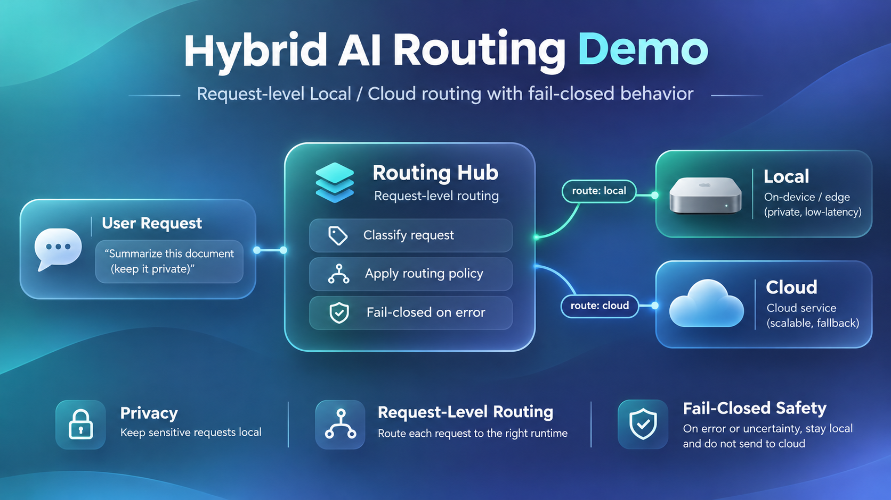
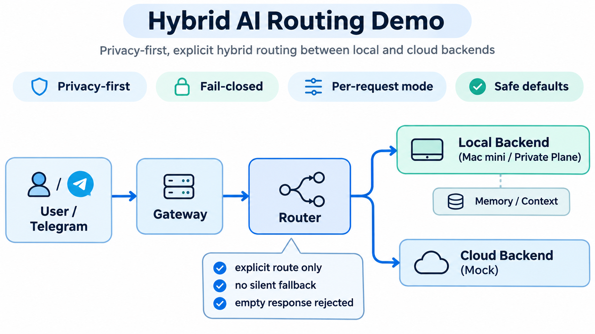

# Hybrid AI Portfolio MVP

## Why I Built This

I built a personal Hybrid AI Assistant connecting a cloud gateway on AWS Lightsail with local AI inference on a Mac mini.

The project began with a practical question: **How can I use local AI models for private tasks while retaining the flexibility of cloud AI, without losing control over routing, security, or failures?**

Through implementation and operation, I explored model routing, network boundaries, service reliability, access control, and recovery procedures.

## Production Experience vs. Public Demo

| | Private Hybrid AI System | This Public Repository |
|---|---|---|
| Purpose | Personal AI assistant | Reproducible routing demonstration |
| Infrastructure | Lightsail and Mac mini | Standalone Python project |
| Models | Local Ollama and separate cloud execution paths | Mock-based demonstration |
| Routing | Real service integration | Explicit Local/Cloud selection |
| Failure handling | Operational safeguards | Tested fail-closed behavior |
| Private data | Kept in private infrastructure | Not included |

**This repository is not a copy of the production system.** It is an independently implemented, clean-room demonstration of selected architectural decisions. It contains no production integration, real model calls, or private data.

### Key Engineering Decisions

- **Explicit routing:** Each request specifies its intended execution path.
- **Privacy-first:** Private requests cannot be forwarded to the cloud path.
- **Fail-closed:** Backend failures and empty responses do not trigger silent fallback.
- **Testability:** Routing behavior is verified without production credentials or external AI services.
- **Clear limitations:** The router handles backend timeout exceptions but does not enforce timeouts itself.

## 프로젝트 소개

개인 하이브리드 AI 비서를 직접 구축·운영하면서 경험한 라우팅, 보안 경계, 장애 처리 설계를 독립적인 공개 데모로 재구현한 프로젝트입니다.

실제 운영 코드와 개인정보는 포함하지 않으며, 공개 저장소에서는 핵심 라우팅 정책과 실패 처리 동작을 재현할 수 있습니다. 이 저장소는 실제 모델 호출이나 운영 서비스 연동을 제공하지 않습니다.

## Architecture



## What This Demo Implements

- A caller explicitly selects `local` or `cloud` for each request.
- Private-classified requests are rejected before the cloud backend is called.
- Backend exceptions and empty output fail closed; the router does not fall back to another provider.
- Automated tests use deterministic in-process fake backends and synthetic prompts.

This is a portfolio demonstration, not a deployable assistant or production security boundary. The cloud backend is a mock and makes no network calls.

## Requirements

Python 3.11 or newer. There are no third-party runtime or test dependencies.

## Run the Local Example

```sh
python3 -m venv .venv
. .venv/bin/activate
PYTHONPATH=src python -m hybrid_ai_portfolio --provider local
PYTHONPATH=src python -m hybrid_ai_portfolio --provider cloud
```

The demo uses a fixed synthetic prompt; arbitrary prompt text is not accepted by its command line. Cloud selection is allowed only for a request classified as public. To see fail-closed behavior, run:

```sh
PYTHONPATH=src python -m hybrid_ai_portfolio --provider cloud --classification private
```

That command exits with an error before a backend is called. All backends in this demo are in-process mocks.

## Run Local CI

```sh
./scripts/ci.sh
```

CI runs unit tests, bytecode compilation, and the public-safety pattern scan. It does not access the network, model services, Telegram, cloud resources, private documents, or local databases.

## Repository Map

- `src/hybrid_ai_portfolio/routing.py`: provider-selection contract and fail-closed router.
- `src/hybrid_ai_portfolio/demo.py`: local-only mock example.
- `tests/`: synthetic unit tests.
- `docs/`: architecture, ownership boundary, decisions, and a sanitized failure scenario.

## Ownership and License

This is a personally planned and developed clean-room project, produced with AI assistance and no company-owned code or materials. See [OWNERSHIP.md](OWNERSHIP.md) for the author's rights representation and the repository provenance boundary. Licensed under the [MIT License](LICENSE).
