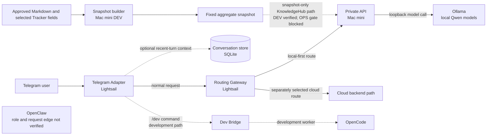

# Hybrid AI Assistant — Personal Project

This project explores how a personal AI assistant can combine private, on-device inference with the flexibility of a cloud model path while keeping routing, data boundaries, and failure behavior understandable.

## Why I Built This

I built a personal Hybrid AI Assistant connecting a cloud gateway on AWS Lightsail with local AI inference on a Mac mini.

The project began with a practical question: **How can I use local AI models for private tasks while retaining the flexibility of cloud AI, without losing control over routing, security, or failures?**

Through implementation and operation, I explored model routing, network boundaries, service reliability, access control, memory, automation, and recovery procedures.

## The Private System and This Repository

| | Personal Hybrid AI System | This Public Repository |
|---|---|---|
| Purpose | Personal assistant and development environment | Small, reproducible routing demonstration |
| Infrastructure | Lightsail, Mac mini, and private services | Standalone Python project |
| Models | Local Ollama plus a separate cloud execution path | In-process mock backends only |
| Routing | Telegram adapter and gateway integrations | Explicit Local/Cloud request contract |
| Knowledge | Private KnowledgeHub inputs and a restricted snapshot design | No private documents or tracker data |
| Operations | Separate services, storage, and access controls | No production configuration or network calls |

**This repository is not a copy of the production system.** It is a clean-room demonstration of selected architectural decisions. The diagram and image below distinguish the broader personal system from the much smaller public demo.

## Full System Architecture

The solid paths show the documented service roles. Dashed paths are development-only or not confirmed as a current production integration. No operational hostnames, addresses, credentials, or private data are included.



### Roles and Integration Status

- **Lightsail Telegram Adapter and Gateway:** The Adapter handles Telegram updates and forwards requests to the Gateway. The Gateway exposes distinct status and inference routes and selects the execution path. Earlier operator checks confirmed the AWS status stage; those services were not re-inspected for this README update.
- **Mac mini Private Plane and Ollama:** The Private Plane API connects to a local Ollama model endpoint. A recorded DEV HTTP run used synthetic documents and made a real local Qwen request. This does not mean the public demo calls Ollama.
- **Local and cloud routing:** Gateway code and tests cover local, automatic, and cloud modes. The tested default prefers the Private Plane and has automatic cloud fallback disabled; a separate cloud route exists. This is not a blanket claim that every production request is classified or guaranteed private.
- **OpenClaw:** OpenClaw is named in the broader project context, but its operational role is not established by the reviewed code and reports. Its direct connection to the Telegram → Gateway → Private Plane request path is also unverified, so the diagram intentionally shows no connection.
- **KnowledgeHub:** A DEV snapshot pipeline reads an explicitly selected Markdown directory and selected Tracker fields, then emits a fixed aggregate schema. The API reader consumes that snapshot and fails closed on missing, stale, or invalid input. The latest recorded G2 status is **OPS BLOCKED**; no live KnowledgeHub search from the production service is claimed here.
- **Conversation memory:** The Telegram Adapter has an optional, bounded recent-conversation store with per-conversation isolation. Tests cover context limits and separation. This is short-term chat context, not KnowledgeHub search or vector memory.
- **Development automation:** A `/dev` path is documented in the Lightsail DEV branch through a local Dev Bridge to an OpenCode worker. A Codex executor is an opt-in prototype, not an always-on production feature. These tools are not included in this public repository.

## Memory, Search, and Automation Are Separate

The system uses three different ideas that should not be conflated:

1. **Conversation context** keeps a bounded window of recent turns for a chat when enabled.
2. **KnowledgeHub search** is designed around a restricted, aggregate-only snapshot. It is not a copy of the Markdown or Tracker source documents, and its OPS rollout remains blocked in the latest recorded release review.
3. **Developer automation** routes an explicit `/dev` request to a separate development worker. It is not the normal chat or KnowledgeHub path.

## Engineering Decisions and Lessons

- **Make route selection explicit.** A request identifies its intended provider; the public demo rejects private-classified requests before a cloud backend can run.
- **Avoid silent route changes.** The Gateway's tested default does not automatically send a failed local request to the cloud. Backend failures do not become successful answers from another provider without an explicit policy.
- **Keep KnowledgeHub output bounded.** The DEV snapshot contract uses an allowlist and freshness/integrity checks. Failure returns unavailable rather than serving an old snapshot. Synthetic tests cover this boundary; production rollout is still blocked.
- **Treat model capacity as a reliability constraint.** Mac memory and swap measurements informed model selection. A larger-model run was stopped by the existing safety guard after resource limits were exceeded; it was not promoted as a default.
- **Separate proof from deployment.** Release, credentials, snapshot ACL, and service-start checks are separate gates. A passing mock or DEV test is not described as a production deployment.
- **Be precise about timeouts.** The Router does not enforce a deadline. If a backend raises a timeout exception, the demo fails closed without fallback.

### Implementation Status

The table separates current public code from private-system work. Private-system entries summarize the latest available reports and code inspection; they were not re-run or independently re-certified during this README update.

| Area | Status | Evidence boundary |
|---|---|---|
| Public Local/Cloud router | **Implemented** | This repository contains the explicit request contract, mock backends, fail-closed checks, and unit tests. |
| Telegram → Gateway request path | **Implemented / operationally reported** | Adapter and Gateway code and synthetic tests exist. Current live Telegram behavior was not checked in this task. |
| Mac local model path | **Implemented / DEV verified** | Local Qwen API behavior was exercised with synthetic input in a recorded DEV run. |
| Conversation context | **Implemented in Adapter; optional** | Stored recent-turn context and its limits are covered by Adapter tests; it is distinct from KnowledgeHub. |
| KnowledgeHub snapshot/search | **DEV implemented; OPS blocked** | Snapshot schema, reader, and synthetic tests exist. Protected runtime, snapshot handoff, and production service readiness were not established in the latest G2 report. |
| `/dev` development automation | **Partial** | A DEV Bridge/OpenCode route and tests exist. The Codex executor remains an opt-in prototype. |
| OpenClaw role and direct integration | **Unverified** | The reviewed sources do not establish its operational role or prove an edge to the Gateway request flow. |
| LFM model selection | **DEV candidate only** | Synthetic tests exist, but release/authentication gates block OPS use; it is not represented as deployed. |

## Recorded Validation

- **This public demo:** 13 unit tests passed after this README-only revision. Tests use synthetic prompts and in-process fakes.
- **Private DEV history (not part of this repository):** a prior Mac G2/G3 audit recorded 57/57 Mac API/release tests and 168/168 Adapter tests. The Gateway HTTP suite at that point recorded 14 PASS and 21 SKIP; the two real servers were not exercised together in that audit.
- **Later synthetic integration report:** an LFM candidate run recorded Mac API and Adapter → Gateway → Mac mock/loopback scenarios as passing. Real LFM inference, Telegram delivery, and OPS deployment were skipped.

These private results are historical evidence, not a claim that this public commit contains those integrations or that current OPS has been revalidated.

## Public Router Demo

The public code is a small technical proof of one decision: route requests explicitly, reject private-to-cloud combinations, and fail closed when the selected backend is unavailable or raises an exception. It does **not** implement the Telegram Adapter, Lightsail Gateway, OpenClaw integration, Ollama client, KnowledgeHub, conversation store, or deployment automation.

### Demo Architecture

The existing architecture image describes only this public router demo, not the full personal system above.


## Run the Demo

Requirements: Python 3.11 or newer. There are no third-party runtime or test dependencies.

```sh
python3 -m venv .venv
. .venv/bin/activate
PYTHONPATH=src python -m hybrid_ai_portfolio --provider local
PYTHONPATH=src python -m hybrid_ai_portfolio --provider cloud
```

The example uses a fixed synthetic prompt and in-process fake backends. To see a private-to-cloud request rejected before a backend is called:

```sh
PYTHONPATH=src python -m hybrid_ai_portfolio --provider cloud --classification private
```

Run the tests and public-safety scan with:

```sh
./scripts/ci.sh
```

The demo makes no network calls and is not a deployable assistant or production security boundary.

## 프로젝트 요약

이 프로젝트는 Mac mini의 로컬 AI와 AWS Lightsail의 게이트웨이를 결합해 개인용 하이브리드 AI 비서를 구축·운영하며 얻은 라우팅, 데이터 경계, 대화 기억, 검색, 자동화 경험을 정리합니다.

공개 저장소는 전체 운영 시스템이 아니라, 요청별 Local/Cloud 선택과 개인정보 요청 차단, 백엔드 실패 시 fail-closed 동작만 합성 테스트로 재현하는 작은 데모입니다. KnowledgeHub snapshot은 DEV 검증과 운영 준비를 구분하며, OpenClaw의 직접 연결처럼 확인되지 않은 경로는 구현 완료로 표시하지 않습니다.

See [OWNERSHIP.md](OWNERSHIP.md) for the clean-room and rights boundary. Licensed under the [MIT License](LICENSE).
