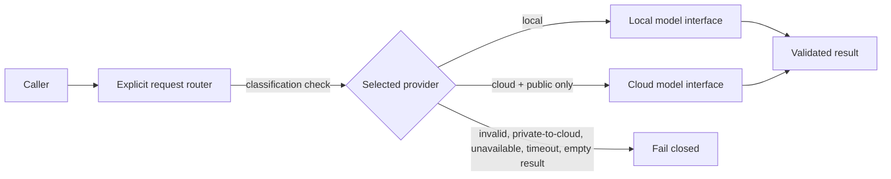

# Architecture

## Request flow

## Contracts

`InferenceRequest` contains a prompt, an explicit provider selection (`local` or `cloud`), and a data classification (`public` or `private`). The router rejects invalid combinations before calling a backend.

The model interface is a protocol with one operation, `infer(prompt) -> str`. Production-specific SDKs and network clients are intentionally absent. The demo backend implementations are deterministic, in-process fakes.

## Failure behavior

The router returns a result only from the selected backend. It does not retry on another provider. An unavailable backend, exception, or blank output becomes a generic routing failure that does not include the prompt or backend exception text. Private data cannot be sent to the cloud interface.

This is an educational example. It does not provide authentication, process isolation, a secrets manager, a production privacy classifier, or a hardened inference service.
