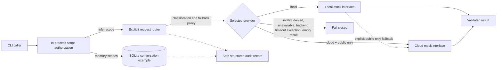

# Architecture

## Public demo request flow

This diagram describes only the standalone public repository. The full personal system is documented separately in the root README and is not implemented by this demo.

## Contracts

`InferenceRequest` contains a prompt, explicit provider selection (`local` or `cloud`), a data classification (`public` or `private`), and an optional fallback policy. `never` is the default. `local_to_cloud` is accepted only when Local is primary and the data class is public. Private requests cannot select Cloud or the fallback policy.

The model interface is a protocol with one operation, `infer(prompt) -> str`. Production-specific SDKs and network clients are intentionally absent. The demo backend implementations are deterministic, in-process fakes. Local-to-Cloud fallback is an explicit request choice, not a retry default; the result records which provider actually handled the request.

## Failure behavior

The router does not enforce a timeout or deadline. If a backend raises a timeout exception, it is handled as a backend failure. The default policy returns a generic failure without trying another provider. An explicitly selected public-only fallback may try the Cloud mock after a Local failure; a Cloud failure still fails closed. Blank output fails as well. Prompt and backend exception text are not exposed in errors or audit logs.

## Authorization, memory, and observability

`TokenAuthorizer` compares an in-process demo token and checks fixed scopes for inference, memory writes, same-session reads, and cross-session search. The CLI generates its token at runtime and does not print it. This is an application-level example, not an HTTP authentication boundary, identity system, or secure token transport.

`ConversationMemory` uses SQLite with parameterized queries, literal search terms, bounded fields/results, and optional session filtering. It defaults to ephemeral `:memory:` storage. Optional persistent mode requires a caller-owned mode-0700 parent and caller-owned mode-0600 database file; it does not encrypt content or replace production data governance.

`PortfolioService` generates request IDs and emits JSON audit records containing only allowlisted route, outcome, and static failure-reason fields. It does not log prompts, credentials, session identifiers, model output, or backend exception text.

This remains an educational, in-process example. It does not provide network service authentication, process isolation, a secrets manager, a production privacy classifier, or a hardened inference service.
